 <div align="center">

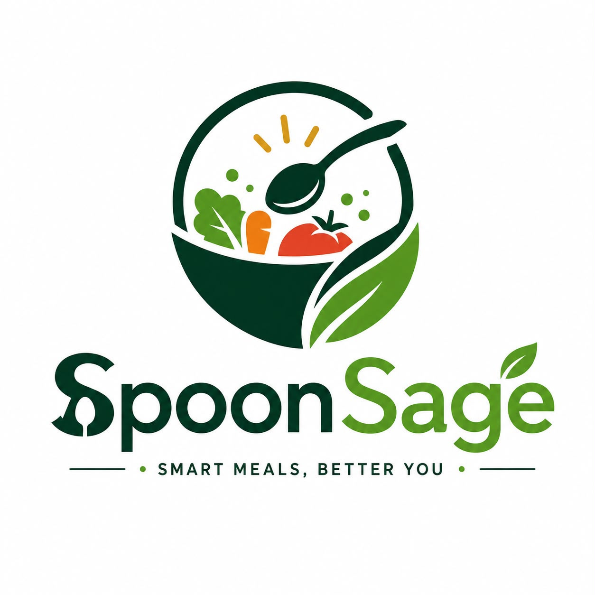

# 🥄 SpoonSage

### 🌿 *Smart meals, better you.*

**Plan meals, shop smarter, and get coached, all in one Android app.**

[](https://github.com/ST10311127/Spoonsage-app-/actions/workflows/build.yml)


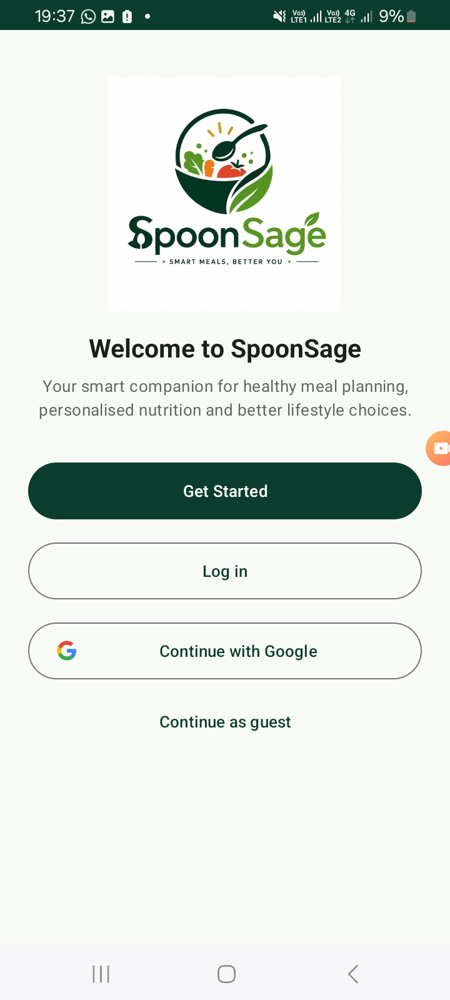 &nbsp; 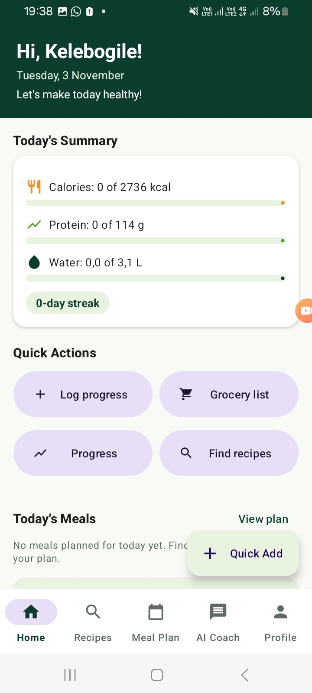 &nbsp; 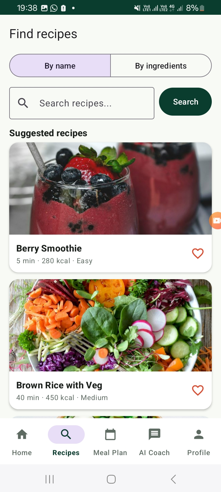 &nbsp; 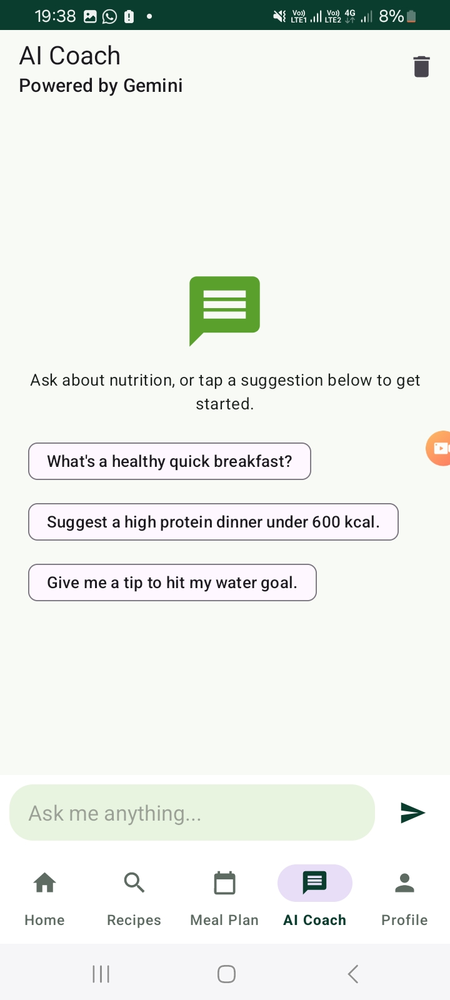

**OPSC6312 · Final Portfolio of Evidence (Part 3) · IIE Faculty of ICT · 2026**
Final release tag: `final-poe`

</div>

SpoonSage is a Kotlin Android app built for the IIE *OPSC6312* Portfolio of
Evidence (Part 3, Final, Learning Units 1 to 4). It combines recipe
discovery, meal planning, a grocery list, progress tracking, and an
AI-powered nutrition coach, backed by Firebase for authentication and cloud
data sync. For the final PoE the app was **rebuilt from Jetpack Compose to
XML layouts with Fragments**, based on the lecturer's feedback.

---

## 🎥 Demonstration Video

> 🔗 **Final PoE (Part 3), narrated demo (unlisted YouTube):**
> **[PASTE YOUR YOUTUBE (UNLISTED) LINK HERE](PASTE_YOUTUBE_LINK_HERE)**

Part 2 prototype video: https://youtube.com/shorts/E55vZXmK7Dw?si=UagstXMojyW5aMLN

The final video (with voice-over) shows, in order:

| # | What is demonstrated |
|---|----------------------|
| 1 | Welcome screen, Get Started and input validation (empty sign-up fields show error messages) |
| 2 | Registering with email and password (encrypted) and completing profile setup |
| 3 | **Google single sign-on:** log out, then Continue with Google |
| 4 | Dashboard, recipe search ("chicken") via the Spoonacular REST API, recipe detail, favourite and Start cooking |
| 5 | Add to plan, Meal Plan tab and the auto-generated Grocery list |
| 6 | **Offline mode with sync:** airplane mode, offline banner, add a grocery item and log progress, reconnect and see the "Back online – synced" notification |
| 7 | **Push notification** sent from the Firebase console, received while the app is in the background |
| 8 | **Settings:** isiZulu, Afrikaans, English and Dark mode |
| 9 | AI Coach (Gemini): tap a suggestion and see the reply |
| 10 | Progress screen, Profile and adding a Reminder |
| 11 | **Firebase console:** Authentication users and Firestore `users/{uid}` data |
| 12 | **GitHub Actions** green build |

---

## Table of Contents

- [Demonstration Video](#-demonstration-video)
- [Group Members](#-group-members)
- [Purpose](#purpose)
- [Design Considerations](#design-considerations)
- [Features](#features)
- [Screenshots](#screenshots)
- [Tech Stack & Architecture](#tech-stack--architecture)
- [REST API & Hosted Services](#rest-api--hosted-services)
- [Offline Mode & Sync](#offline-mode--sync)
- [Setup & Installation](#setup--installation)
- [Utilisation of GitHub](#utilisation-of-github)
- [GitHub Actions (CI)](#github-actions-ci)
- [Testing](#testing)
- [Release Notes](#release-notes)
- [Publishing (Google Play Store)](#publishing-google-play-store)
- [AI Usage Disclosure](#ai-usage-disclosure)
- [References](#references)

---

## 👥 Group Members

| Name | Student Number |
|------|----------------|
| Lebogang Ntlatleng | ST10456295 |
| Mpho Nethomboni | ST10448422 |
| Mulamuleli Given Mutshotsho | ST10311127 |
| Portia Mashaba | ST10357369 |
| Munei Nevhutanda | ST10333563 |

---

## Purpose

Meal planning is tedious to do well: juggling what's in the fridge, what fits
a diet, what's actually nutritious, and turning that into a shopping list.
**SpoonSage's target audience** is anyone trying to eat more intentionally,
students and young professionals in particular, who wants a single app that
plans meals *and* nudges them toward their goals, instead of a spreadsheet
plus three different apps.

SpoonSage solves this by combining:
- real recipe data (via the Spoonacular API),
- a weekly meal plan and an auto-generated grocery list,
- daily tracking of calories, protein and water with streaks, and
- an AI Coach that gives short, practical nutrition advice on request.

It is built for South African users: the whole app is available in
**English, isiZulu and Afrikaans**, and it keeps working **without internet**.

## Design Considerations

- **XML + Fragments (rebuilt for Part 3):** every screen is a `Fragment` with
  its own XML layout, connected through **ViewBinding** (e.g.
  `fragment_login.xml` → `FragmentLoginBinding`). This replaces the Part 2
  Jetpack Compose UI, as requested in the lecturer's feedback. Two activities
  host the fragments: `AuthActivity` (welcome, login, register, profile setup)
  and `MainActivity` (bottom navigation with Home, Recipes, Meal Plan,
  AI Coach and Profile).
- **Single repository:** all screens get their data from one
  `SpoonSageRepository`, never from the database or network directly.
  Screens observe Room `LiveData`, so they update automatically.
- **Offline-first:** RoomDB is the local source of truth for recipes, the meal
  plan, grocery list, progress logs, reminders and AI chat history, so the app
  stays usable without a connection. Changes are synced to Firestore when the
  phone reconnects.
- **Why Firebase:** Authentication + Firestore + Cloud Messaging give a
  production-grade, genuinely hosted backend without running and paying for a
  custom server for marking.
- **Why Gemini via Firebase AI Logic:** it has a free tier with no billing
  account and reuses the same Firebase project as Auth and Firestore.
- **Security:** passwords are handled by Firebase Auth; the offline login copy
  is a salted PBKDF2 hash. The Spoonacular key lives in `local.properties`
  (not committed) and is masked in logs. Firestore rules only allow users to
  access their own data.
- **UI/UX:** colours taken from the logo (dark green `#0B3D2E` and leaf green
  `#5BA02E`), Material 3 components, full dark mode, empty states, loading
  indicators, an orange "You're offline" banner, and input validation on every
  form so invalid input never crashes the app.

## Features

| Feature | Status | Notes |
|---|---|---|
| Recipe search (by ingredient & by name/diet) | ✅ Implemented | Spoonacular REST API via Retrofit |
| Recipe detail, favourites & cooking mode | ✅ Implemented | Step-by-step, keeps screen on |
| Meal planning (assign recipes to days & meals) | ✅ Implemented | Room + Firestore |
| Auto-generated grocery list | ✅ Implemented | Room + Firestore |
| Progress tracking (calories/protein/water + streak) | ✅ Implemented | 7-day chart, 3/7/14-day badges |
| AI Coach chat with dish suggestions | ✅ Implemented | Gemini via Firebase AI Logic |
| Sign up / log in with encrypted password | ✅ Implemented | Firebase Auth + PBKDF2 hash for offline login |
| **Single sign-on (Google)** | ✅ **New in Part 3** | Credential Manager + Firebase Auth |
| Continue as guest | ✅ Implemented | Data stays on the phone |
| Settings / profile editing | ✅ Implemented | Language, theme, notifications, sync, personal info, diet, goals |
| **Offline mode with sync** | ✅ **New in Part 3** | RoomDB → Firestore on reconnect |
| **Real-time push notifications** | ✅ **New in Part 3** | Firebase Cloud Messaging |
| **Daily reminders** | ✅ **New in Part 3** | Water / meal / log progress (AlarmManager) |
| **Multi-language (isiZulu & Afrikaans)** | ✅ **New in Part 3** | Per-app language setting |
| **Dark mode** | ✅ **New in Part 3** | Light / dark / follow phone |

## Screenshots

Screenshots are taken on a physical Android phone and stored in the
[`pictures/`](pictures) folder.

| Screen | Preview | Description |
|--------|---------|-------------|
| **Welcome** |  | Entry point with Get Started, Log in, Continue with Google and Continue as guest. |
| **Log in** | 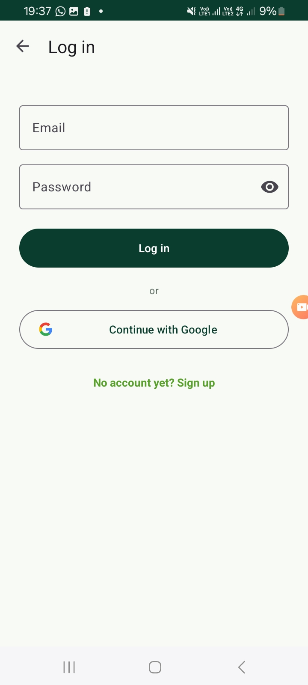 | Email and password login with show/hide password, Google single sign-on and a sign-up link. |
| **Tell us about yourself** | 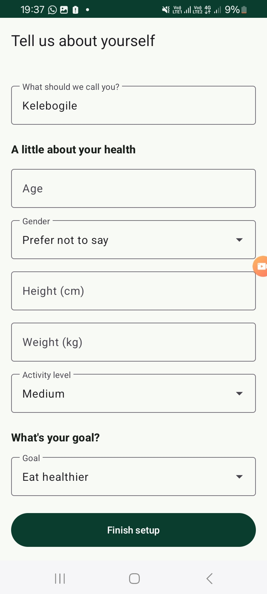 | Profile setup collecting name, age, gender, height, weight, activity level and goal. |
| **Home dashboard** |  | Daily summary of calories, protein, water and streak, with quick actions and today's meals. |
| **Recipe** |  | Recipe detail with ingredients, steps and nutrition (Spoonacular). |
| **Meal plan** | 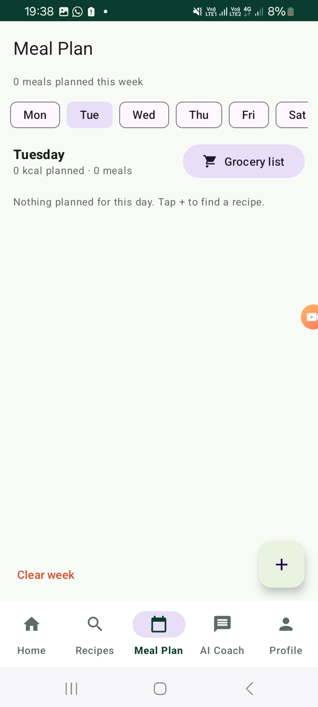 | Weekly plan by day with a shortcut to the auto-generated grocery list. |
| **AI Coach** |  | Gemini-powered nutrition chat with tappable suggestions. |
| **Profile** | 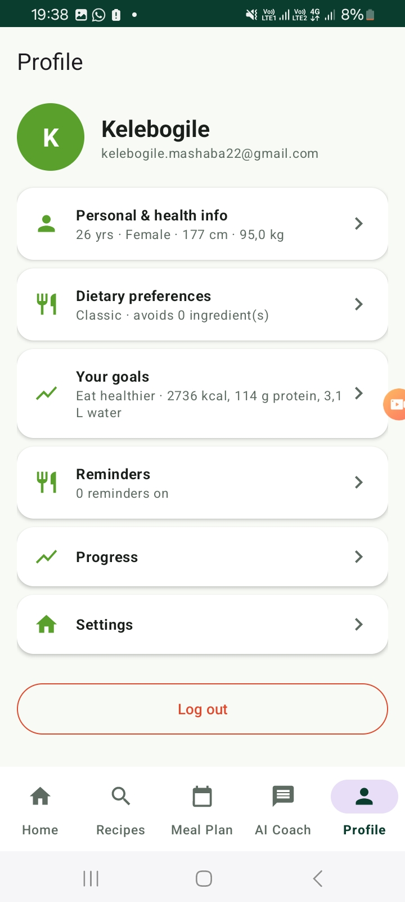 | Personal and health info, dietary preferences, goals, reminders, progress and settings. |
| **Language** | 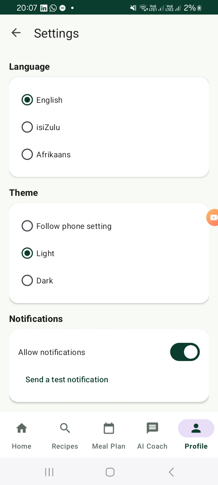 | Language settings: English, isiZulu and Afrikaans. |

## Tech Stack & Architecture

**Language & UI:** Kotlin, XML layouts, Fragments, ViewBinding, Material 3
**Local storage:** RoomDB (offline database), SharedPreferences (settings)
**Networking:** Retrofit + OkHttp + Gson (Spoonacular)
**Cloud services:** Firebase Authentication, Cloud Firestore, Firebase Cloud
Messaging, Gemini via Firebase AI Logic
**Sign-in:** Android Credential Manager (Google SSO)
**Async:** Kotlin Coroutines & LiveData
**Images:** Glide
**Testing:** JUnit4
**CI/CD:** GitHub Actions

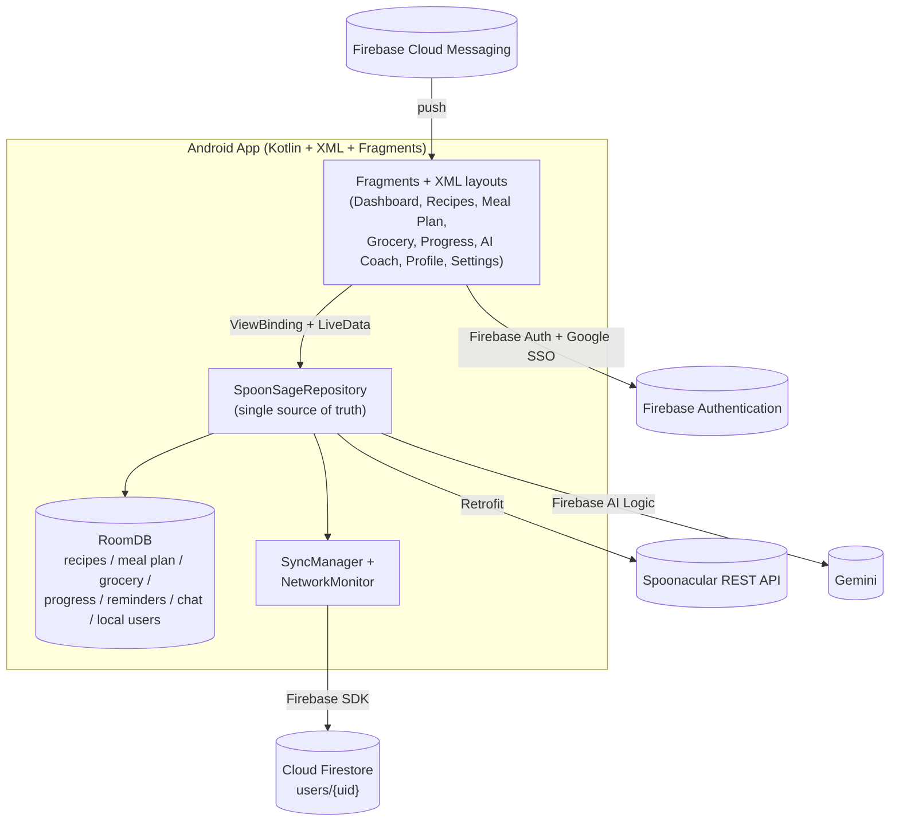

## REST API & Hosted Services

SpoonSage uses hosted, internet-based services connected to real databases:

### 1. Spoonacular (third-party REST API → recipe database)

Base URL: `https://api.spoonacular.com/`, called with **Retrofit**
(`data/remote/SpoonacularApi.kt`). An OkHttp interceptor adds the API key to
every request and masks it in Logcat.

| Endpoint | Method | Used for |
|---|---|---|
| `/recipes/complexSearch` | GET | Search by name, filtered by diet & disliked ingredients |
| `/recipes/findByIngredients` | GET | Search recipes by ingredients the user already has |
| `/recipes/{id}/information` | GET | Full recipe detail: ingredients, steps, nutrition |

Example request (ingredient search):
```
GET https://api.spoonacular.com/recipes/findByIngredients
    ?ingredients=chicken,rice,broccoli
    &number=20
    &apiKey=YOUR_SPOONACULAR_API_KEY
```

### 2. Firebase (hosted auth, NoSQL database and messaging)

- **Firebase Authentication:** email/password accounts and **Google
  sign-in**. Firebase hashes the password on its servers.
- **Cloud Firestore:** hosted NoSQL database:

  | Path | Data |
  |---|---|
  | `users/{uid}` | profile, goals, diet, dislikes, daily targets, FCM token |
  | `users/{uid}/mealPlan/{id}` | meal plan entries |
  | `users/{uid}/grocery/{id}` | grocery list items |
  | `users/{uid}/progress/{date}` | daily calories, protein, water, streak |

- **Firebase Cloud Messaging:** real-time push notifications (topic
  `spoonsage_tips` + each user's token).
- **Firebase AI Logic (Gemini):** hosted model inference for the AI Coach.

> For the demonstration video: the Firebase console's **Authentication** tab
> (registered email + Google users), the **Firestore** tab (`users/{uid}` and
> its sub-collections), and Spoonacular API calls in **Logcat** (filter
> `RetrofitClient`) are shown.

## Offline Mode & Sync

1. Every change (meal plan, grocery list, progress log) is saved to **RoomDB
   first**, marked `synced = false`.
2. Deletes made offline are marked `pendingDelete = true` instead of being
   removed straight away.
3. `NetworkMonitor` watches the connection and shows an orange banner while
   offline.
4. When the phone reconnects, `SyncManager` uploads the waiting changes to
   Firestore, marks them synced, and shows a **"Back online – X changes
   synced"** notification.
5. Settings shows the online status, the number of changes waiting and the
   last sync time, with a **Sync now** button.
6. **Offline login:** after one online login, a salted PBKDF2 hash of the
   password is kept in RoomDB so the user can log in without internet.

## Setup & Installation

1. **Clone the repo:**
   ```bash
   git clone https://github.com/ST10311127/Spoonsage-app-.git
   ```
2. **Get a free Spoonacular API key:** https://spoonacular.com/food-api →
   add it to `local.properties` (this file is not committed):
   ```
   SPOONACULAR_API_KEY=your_key_here
   ```
3. **Set up Firebase** and put `google-services.json` in the `app/` folder:
   - Authentication → enable **Email/Password** and **Google**
   - Project settings → add your debug **SHA-1** (needed for Google sign-in)
   - Create a **Firestore** database and paste in `firestore.rules`
   - Enable **AI Logic** (Gemini Developer API)
4. **Open in Android Studio** (Ladybug or newer), set **Gradle JDK** to
   **jbr-21**, let Gradle sync, then **Run ▶** on a physical phone
   (minSdk 26 / Android 8.0+).

**Send a test push notification:** Firebase console → Messaging → New
campaign → Notification → target the topic `spoonsage_tips`.

## Utilisation of GitHub

- The repository was initialised with a **README.md** from the start.
- Code was **committed and pushed regularly** as features were built (auth,
  meal planning, grocery list, progress, AI Coach, Firebase, offline sync,
  notifications, languages), giving a meaningful commit history.
- `.gitignore` keeps secrets and generated files out of the repository
  (`local.properties`, the signing keystore and build output).
- Extra setup notes are kept out of the main README where possible.
- All source code, this README and the CI workflow live in this one public
  repository. **No zip files** were submitted.
- The final commit is tagged **`final-poe`**.

**Repository:** https://github.com/ST10311127/Spoonsage-app-

## GitHub Actions (CI)

[`.github/workflows/build.yml`](.github/workflows/build.yml) runs
automatically on every push and pull request:

1. Checks out the code.
2. Uses `app/google-services.json` (or writes it from the
   `GOOGLE_SERVICES_JSON` secret if provided).
3. Sets up JDK 17 and caches Gradle dependencies for faster runs.
4. Runs `./gradlew testDebugUnitTest`. All unit tests must pass.
5. Runs `./gradlew assembleDebug`. The app must compile.
6. Uploads the unit test report and the built debug APK as workflow
   artifacts.

**Why:** this proves the app builds and its tests pass on a clean machine,
not just "on my computer".

**Repository secret:** add `SPOONACULAR_API_KEY` (Settings → Secrets and
variables → Actions → New repository secret) so the CI-built APK can load
recipes.

<!-- Upload the green build screenshot to pictures/github_actions_green.png -->


## Testing

Unit tests live under `app/src/test/java/com/spoonsage/app/` and run on the
plain JVM (no emulator needed) using JUnit4:

| Test class | Covers |
|---|---|
| `PasswordHasherTest` | Correct password verifies, wrong one fails, hash never contains the password, salts differ |
| `ValidatorsTest` | Invalid emails, short passwords, non-numbers and out-of-range values are rejected |
| `TargetCalculatorTest` | Calorie / protein / water targets (Mifflin-St Jeor + goal) |
| `StreakCalculatorTest` | Daily-logging streak rules (same day / next day / gap) and badges |
| `CoachReplyParserTest` | Parsing Gemini's reply into chat text + an optional dish suggestion; recipe helpers |

**Run them:**
```bash
./gradlew testDebugUnitTest
```
Reports are written to `app/build/reports/tests/testDebugUnitTest/index.html`.

## Release Notes

### v3.0.0, Final PoE (Part 3)

**Rebuild**
- Whole UI rewritten from **Jetpack Compose to XML layouts + Fragments +
  ViewBinding** (lecturer feedback).
- **DataStore → SharedPreferences** for settings; profile also stored in
  Firestore.
- Spoonacular key moved from `build.gradle.kts` to `local.properties`.
- Coil replaced by Glide for images; Room now uses KSP.

**New innovative features in this version**
- 🔐 **Google Single Sign-On** (Credential Manager + Firebase Auth).
- 📴 **Offline mode with sync:** meal plan, grocery list and progress work
  with no internet and sync to Firestore on reconnect, with a notification and
  sync status in Settings.
- 🔑 **Offline login** with an encrypted (salted PBKDF2) password hash.
- 🔔 **Real-time push notifications** with Firebase Cloud Messaging.
- ⏰ **Daily reminders** (water / meal / log progress) that survive a restart.
- 🌍 **Multi-language:** English, **isiZulu** and **Afrikaans**.
- 🌙 **Dark mode** and theme setting.
- 📊 Progress screen with a **7-day calorie chart**, weekly averages and
  **3/7/14-day streak badges**.
- ✅ Input validation on every form, so bad input does not crash the app.
- 🧪 Unit tests + GitHub Actions CI.

### v2.0.0, Part 2 prototype (September 2026)
- Built in **Jetpack Compose** with MVVM (ViewModels + StateFlow), Room,
  DataStore and Retrofit.
- Recipe search (Spoonacular), recipe detail and cooking mode, meal plan,
  grocery list, progress logging with streaks, reminders.
- AI Coach using Gemini via Firebase AI Logic (replaced the paid Anthropic API).
- Firebase Authentication (email/password + anonymous guest) and Firestore
  profile sync.
- GitHub Actions workflow running unit tests and building the debug APK.

### v1.0.0, Part 1
- Research, design and planning of SpoonSage's features.

## Publishing (Google Play Store)

1. **Signed release build:** *Build → Generate Signed App Bundle / APK* →
   create `spoonsage-release.jks` (kept private, never committed) → **release**.
2. Release builds use **R8 minification + resource shrinking**
   (`proguard-rules.pro`).
3. Store assets: 512×512 icon, phone screenshots and a 1024×500 feature
   graphic.
4. Upload the `.aab` in **Google Play Console → Testing → Internal testing**,
   complete the content rating and Data safety form.

<!-- Add the screenshots to pictures/: signed_apk.png and play_console.png -->
| Signed APK / AAB | Google Play Console |
|---|---|
|  |  |

## AI Usage Disclosure

See **[AI_USAGE.md](AI_USAGE.md)** (maximum 500 words) for how AI tools were
used and cited in Part 2 and Part 3.

## References

- Android Developers (2025) *Fragments*. https://developer.android.com/guide/fragments
- Android Developers (2025) *View binding*. https://developer.android.com/topic/libraries/view-binding
- Android Developers (2025) *Save data in a local database using Room*. https://developer.android.com/training/data-storage/room
- Android Developers (2025) *Per-app language preferences*. https://developer.android.com/guide/topics/resources/app-languages
- Android Developers (2025) *Sign in with Google (Credential Manager)*. https://developer.android.com/identity/sign-in/credential-manager-siwg
- Firebase (2025) *Firebase Authentication*. https://firebase.google.com/docs/auth
- Firebase (2025) *Cloud Firestore*. https://firebase.google.com/docs/firestore
- Firebase (2025) *Firebase Cloud Messaging*. https://firebase.google.com/docs/cloud-messaging [Accessed 03 November 2025]
- Firebase (2025) *Firebase AI Logic*. https://firebase.google.com/docs/ai-logic
- Square (2025) *Retrofit*. https://square.github.io/retrofit/
- Spoonacular (2025) *Food API documentation*. https://spoonacular.com/food-api/docs
- IMAD5112 (2025) *GitHub Actions build.yml*. https://github.com/IMAD5112/Github-actions/blob/main/.github/workflows/build.yml [Accessed 03 November 2025]
- OWASP (2025) *Password Storage Cheat Sheet*. https://cheatsheetseries.owasp.org/cheatsheets/Password_Storage_Cheat_Sheet.html
- Mifflin, M.D. et al. (1990) 'A new predictive equation for resting energy expenditure in healthy individuals', *American Journal of Clinical Nutrition*, 51(2), pp. 241–247.

---

<div align="center">

**Authors:** Lebogang Ntlatleng · Mpho Nethomboni · Mulamuleli Given Mutshotsho (ST10311127) · Portia Mashaba · Munei Nevhutanda
*OPSC6312, Final Portfolio of Evidence (Part 3) · IIE Faculty of ICT*

*Smart meals, better you.* 🥄🌿

</div>
